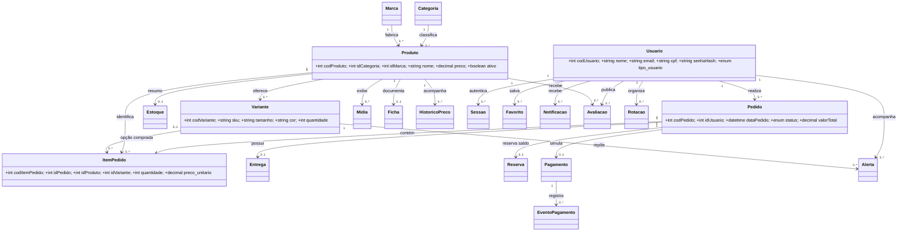
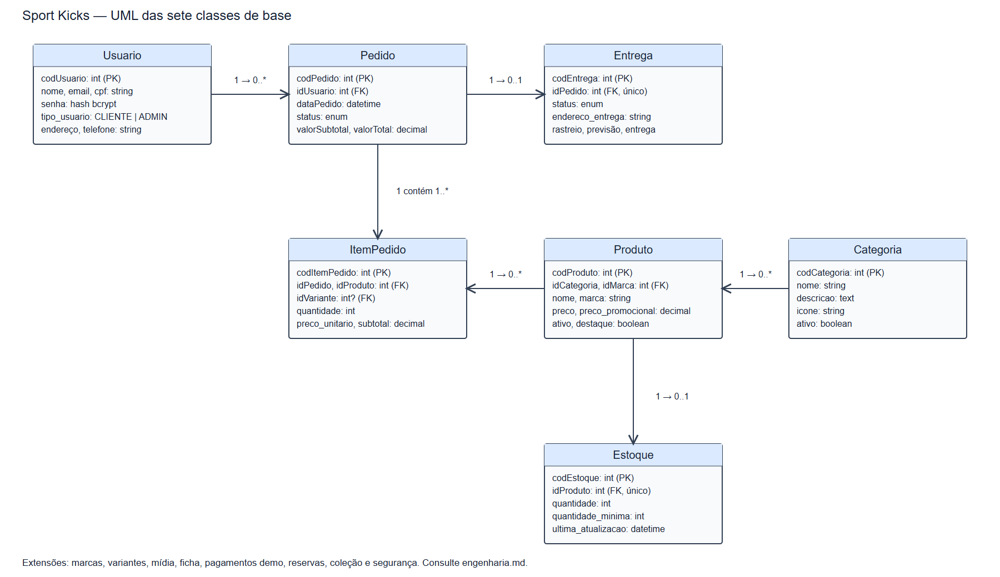
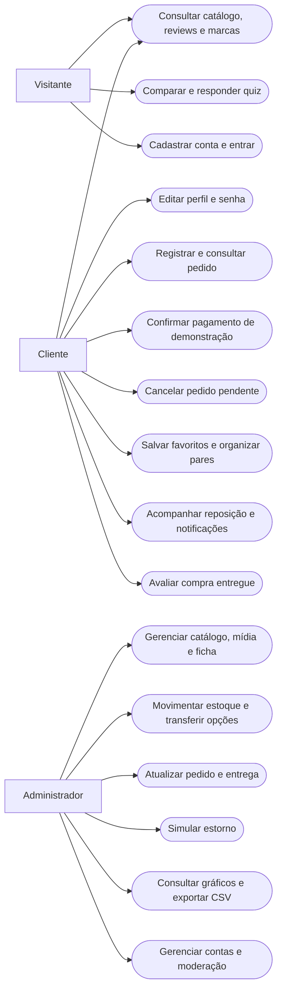
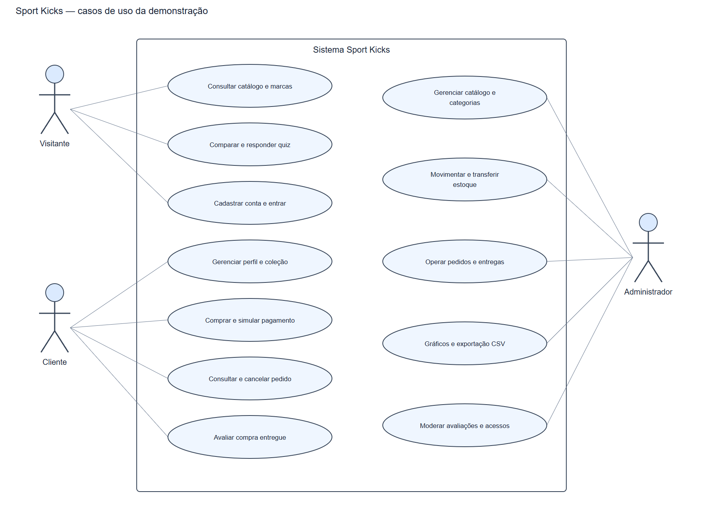

# Engenharia do Sport Kicks

Revisão de implementação: 27/10/2026. A especificação original de sete tabelas foi adaptada para calçados e ampliada. O original permanece no repositório como referência da atividade. Esta versão usa pagamento somente de demonstração, conforme decisão do responsável.

## Requisitos funcionais

| Código | Requisito | Implementação |
| --- | --- | --- |
| RF01 | Vitrine e catálogo públicos com cards | Página inicial e catálogo com consulta automática |
| RF02 | Consulta por código/nome e filtros | API de produtos; busca, marca, categoria, preço e ordenação no frontend |
| RF03 | Cadastro e login | CPF matemático, ViaCEP, bcrypt e JWT |
| RF04 | Carrinho local | LocalStorage, quantidade, remoção e resumo |
| RF05 | Checkout autenticado | Produtos/opções ativos, preço do banco, endereço e totais validados no servidor |
| RF06 | Pedido transacional | Pedido, itens, entrega, reserva, pagamento demo, movimentos e estoque na mesma transação |
| RF07 | Evitar duplicação de confirmação | Chave por usuário e resumo da tentativa; reutilização incompatível é rejeitada |
| RF08 | Histórico privado | Filtro e paginação somente das compras do titular |
| RF09 | Perfil e senha | PATCH do próprio perfil, senha atual para troca e revogação de sessões |
| RF10 | Administração | Produtos, categorias, mídia, ficha técnica, usuários, marcas e moderação |
| RF11 | Estoque por opção | SKU único, tamanho/cor, entrada, saída, ajuste e transferência com motivo |
| RF12 | Entregas | Dados cadastrados e status operados pelo administrador e consultados pelo titular |
| RF13 | Dois relatórios gráficos | Chart.js: valor mensal de pedidos confirmados e subtotal por categoria; período, tabelas e CSV |
| RF14 | Cancelamento e prazo | Reposição única de estoque em cancelamento/expiração; antes do envio |
| RF15 | Pagamento de demonstração | Confirmação explícita sem cobrança; estorno simulado administrativo |
| RF16 | Comparador e quiz | Até três modelos; critérios de disponibilidade, orçamento e finalidade documentada |
| RF17 | Coleção | Favoritos, rotação por uso, alertas e notificações dentro da conta |
| RF18 | Avaliações verificadas | Nota, comentário e ajuste apenas para produto de pedido próprio entregue |
| RF19 | Marcas | Cinco fabricantes com espaço e controles equivalentes e canais oficiais |
| RF20 | Recuperação de acesso | Link de uso único com 20 minutos, hash no banco e envio SMTP opcional |

## Requisitos não funcionais

- **Tecnologia:** HTML/CSS/JS puro; Node.js 22–24, Express, Sequelize, MySQL 8+. Não há dependência de framework de frontend.
- **Responsividade:** verificação em 390×844 e 1366×768; tabelas largas têm rolagem própria.
- **Acesso:** autenticação e autorização na API; controles do navegador servem à navegação e não substituem a permissão do servidor.
- **Segurança:** allowlist de campos, validação de tamanho/tipo, bcrypt, JWT HS256, sessões revogáveis, limite de tentativas e Helmet. CORS restringe origens em produção.
- **Integridade:** bloqueios pessimistas e transações para estoque, confirmação, cancelamento e transferências.
- **Reprodutibilidade:** lockfile, migrações identificadas, carga de demonstração que preserva registros existentes e pipeline de testes.
- **Publicação:** frontend público isolado em `dist`; API e banco fora da saída estática; segredos somente no ambiente.
- **Acessibilidade:** formulários com rótulos, estados de carregamento/erro, navegação por teclado, foco visível e tabelas correspondentes aos gráficos.
- **Dados corretos:** ausência de estrelas fictícias, contadores comerciais inventados ou especificações inferidas. Histórico de preço começa na primeira observação.

## Regras de negócio

1. O cliente pode consultar a vitrine e manter carrinho sem login; finalizar exige sessão válida.
2. Uma opção vendável é identificada por produto, tamanho, cor e SKU. Seu saldo limita a compra. O estoque antigo agregado é mantido como resumo das opções ativas.
3. Estoque legado é convertido sem multiplicar saldo. A numeração desconhecida aparece como **Não informado**; o administrador distribui unidades por transferência.
4. Quantidades do pedido são inteiras positivas; linhas repetidas consomem a disponibilidade somada da mesma opção.
5. Preço e desconto não são aceitos do navegador como fonte de cálculo. Os itens guardam preço, nome e imagem observados no registro da compra.
6. Desconto não cumulativo: subtotal a partir de R$ 1.500 → 15%; R$ 800 → 10%; R$ 400 → 5%; caso contrário, três ou mais unidades → 5%.
7. Frete demonstrativo: a partir de R$ 500 → zero; R$ 200 → R$ 15,90; abaixo → R$ 25,90. Não há cotação de transportadora.
8. A chave de confirmação identifica uma tentativa do titular. A mesma chave com os mesmos dados retorna o pedido original; com outros dados retorna conflito.
9. A reserva de novos pedidos dura 30 minutos por padrão, configurável entre 5 e 1440. Pedidos pendentes anteriores à migração ganham uma reserva de 24 horas a partir dela. A revisão de vencimento é periódica e idempotente.
10. O cliente cancela pedidos pendentes. Após confirmação, a administração conduz cancelamento/estorno. Pedido enviado não devolve estoque automaticamente.
11. Pagamento aprovado impede cancelamento simples. O estorno de demonstração antes do envio cancela e repõe; após envio/entrega registra o estorno sem presumir devolução física do produto.
12. Transições do pedido: PENDENTE → CONFIRMADO → EM_SEPARACAO → ENVIADO → ENTREGUE. CANCELADO é terminal e não pode ser reaberto pelo mesmo fluxo.
13. Mudanças de acesso dependem de administrador ativo; não é permitido remover o próprio acesso administrativo nem o último administrador ativo.
14. Troca/redefinição de senha revoga sessões anteriores. O carrinho local é preservado ao sair.
15. A ficha técnica exige fonte HTTPS oficial de uma marca do catálogo. O quiz não inventa informações ausentes e explica os critérios de seleção.
16. Avaliações são únicas por usuário, produto e pedido entregue. A administração pode ocultar conteúdo, sem transformá-lo em avaliação fictícia.
17. O alerta de uma opção esgotada é de uso único: ao repor de zero para saldo positivo, cria notificação na conta e desativa a inscrição. Não há envio de publicidade automática por e-mail.

## Modelagem

Existem **25 tabelas de domínio**, mais `schema_migrations` para controle técnico. As sete entidades originais permanecem.

| Domínio | Tabelas |
| --- | --- |
| Base original | `usuarios`, `produtos`, `categorias`, `estoque`, `pedidos`, `itens_pedido`, `entregas` |
| Catálogo ampliado | `marcas`, `produto_variantes`, `produto_midias`, `produto_fichas`, `historico_precos` |
| Operação e pagamento demo | `movimentacoes_estoque`, `checkout_chaves`, `reservas_pedido`, `pagamentos`, `eventos_pagamento` |
| Experiência do cliente | `favoritos`, `alertas_disponibilidade`, `notificacoes`, `avaliacoes`, `rotacao_tenis` |
| Segurança | `seguranca_conta`, `sessoes`, `recuperacoes_senha` |

### Classes e relacionamentos principais

O diagrama resume associações de domínio, não todas as colunas/constraints. `idMarca` e `idVariante` são opcionais para compatibilidade com registros antigos. O código de referência dos modelos fica em `backend/models/rel.js` e `backend/models/evolucao.js`.

### Casos de uso

As exportações em PNG dos diagramas principais estão em `docs/diagramas/`. São geradas por `node tools/gerar-diagramas.js` usando o navegador local, a partir de SVGs mantidos junto dos PNGs.

## Infraestrutura

| Ambiente | Necessário |
| --- | --- |
| Desenvolvimento | Windows/Linux/macOS; Node.js 22–24; npm; MySQL 8+; navegador; editor; Git |
| Validação | Usuário MySQL com criação de bancos de teste; Playwright/Chrome ou Chromium; Python com Markdown para regenerar o manual em PDF |
| Vercel | Site estático gerado em `dist`, variável pública `API_BASE_URL`, domínio HTTPS |
| Railway | Serviço Node/Docker, serviço MySQL persistente, conexão privada, segredo JWT, origens CORS e health check |
| SMTP opcional | Credenciais do serviço de envio para recuperação de senha; alertas de estoque continuam dentro da conta |
| Operação | Backups do MySQL testados em restauração, logs sem credenciais, revisão de contas ADMIN e atualização de dependências |

Dimensionamento depende da carga e deve ser medido. Esta implementação não fixa hardware comercial ou promete capacidade sem teste de carga. O pool da API usa até dez conexões por instância; alinhe esse valor ao limite do banco antes de escalar.

## Verificação

As suítes em `backend/tests` combinam APIs e bancos isolados, navegador com respostas controladas e fluxos reais de navegador/API/MySQL. Cobrem permissões, concorrência, rollback, duplicação, validade de reserva, demonstração de pagamento/estorno, estoque, alertas, avaliações, recuperação e responsividade.

`backend/rest_client.http` contém exemplos para inspeção manual. A publicação e seu teste externo ainda dependem de criação e configuração das contas de hospedagem, conforme `docs/publicacao.md`.
